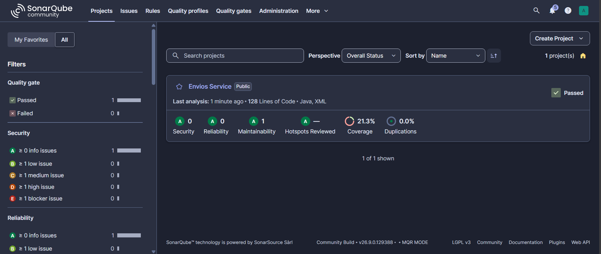
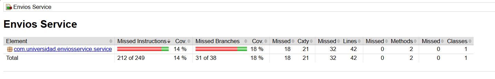
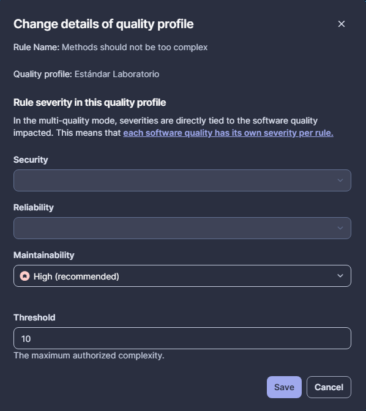
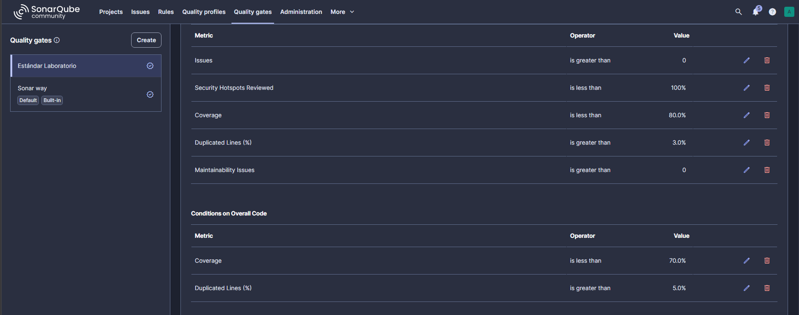
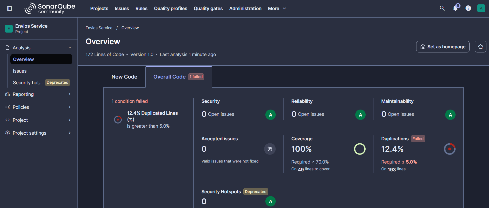
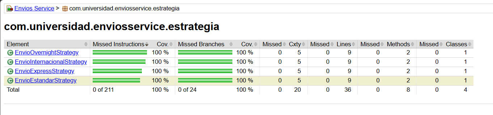

# Envios Service — Diagnóstico y Mejora Guiada por Métricas

Post-contenido de la Unidad 10 de Patrones de Diseño de Software.
Proyecto Maven (`envios-service`) que calcula el costo de un envío
según el método de transporte, el peso, la distancia, la fragilidad
y el tipo de cliente. La Parte 1 lo analiza con SonarQube y JaCoCo
sin corregir nada; la Parte 2 aplica un patrón para bajar la
complejidad, agrega las pruebas que faltaban, configura un Quality
Gate y vuelve a medir.

## Decisiones de diseño

### 1. Entorno de análisis: SonarQube local con Docker
- *Control total de la configuración.* La Parte 2 pide duplicar el
  perfil "Sonar way", activar la regla S1541 con su umbral y crear un
  Quality Gate propio. En el plan gratuito de SonarCloud los perfiles
  y Quality Gates personalizados no están disponibles (solo en los
  planes Team y Enterprise), así que con SonarCloud no habría podido
  terminar el laboratorio.
- *No depende de conectividad ni de límites de un plan.* El análisis
  corre contra `http://localhost:9000`, sin cuenta externa y sin que
  el proyecto quede visible para cualquiera.
- *Costo asumido:* el contenedor consume memoria del equipo y hay que
  dejarlo corriendo durante todo el laboratorio. Para un proyecto de
  pocas clases ese costo es aceptable.

### 2. Exclusiones del análisis: ninguna
Todas las clases de producción son lógica de negocio
(`ServicioCalculoEnvio` y las estrategias). No hay clase `Main`, ni
configuración, ni DTOs, que son los casos que la guía recomienda
excluir porque bajan el porcentaje de cobertura sin decir nada sobre
la calidad del código de negocio. Excluir algo aquí sería esconder
justo el código que se quiere medir. Si más adelante se agregara una
clase de arranque sin lógica, se excluiría con
`sonar.exclusions=**/Main.java`.

### 3. Métrica usada como señal principal: Cyclomatic Complexity
Se usó la complejidad ciclomática para elegir qué intervenir por tres
razones: dice cuántos caminos independientes tiene el método, y por lo
tanto cuántas pruebas hacen falta; cada punto que suma es un
condicional concreto que se puede ubicar en el código; y es el número
que debe bajar si el refactor realmente reparte las decisiones.

- *Por qué no Coverage:* el 18,4 % inicial dice que faltan pruebas,
  pero no por qué es difícil escribirlas. Es una consecuencia. Si solo
  se mirara la cobertura, la solución parecería "agregar 18 pruebas" a
  un método que seguiría igual de frágil.
- *Por qué no Cognitive Complexity:* es la métrica con la que
  SonarQube levantó el Code Smell inicial (32 frente a 15) y confirma
  el mismo método, pero penaliza el anidamiento y mide qué tan difícil
  es de leer. No se traduce en un número de casos de prueba, que es lo
  que conecta el diagnóstico con la cobertura.

En este proyecto las tres señales apuntan al mismo método porque son
el mismo problema visto de formas distintas: un método con CC = 20
necesita al menos 20 casos de prueba (Sección 3.3 de la guía) y la
suite inicial solo tenía 2.

### 4. Patrón elegido: Strategy
**Característica del método que lo decide.** Cada rama de
`metodoEnvio` calcula el mismo tipo de resultado (un costo) con una
fórmula propia, y esa rama se elige una sola vez por un valor discreto
de entrada. Entre ESTANDAR, EXPRESS, OVERNIGHT e INTERNACIONAL no hay
orden ni dependencia: son cuatro algoritmos intercambiables con la
misma firma, `calcular(pesoKg, distanciaKm)`.

**Por qué se descartó State.** `calcularCosto()` recibe todo por
parámetro y `ServicioCalculoEnvio` no recuerda nada entre una llamada
y la siguiente. No hay un estado interno que cambie ni transiciones
válidas o inválidas: un envío ESTANDAR no "pasa" a EXPRESS después de
calcularse. Sin estado que recordar, State no tiene nada que modelar.

**Por qué se descartó Chain of Responsibility.** No hay una secuencia
de manejadores donde el orden importe ni donde más de uno pueda
aplicar: para cada solicitud aplica exactamente un método de envío y
se sabe cuál desde el principio. Con una cadena, cada eslabón tendría
que preguntar "¿es mi método?" antes de pasar al siguiente, que es la
misma cadena de `else if` original repartida en clases.

**Qué se movió y qué se quedó.** A las estrategias se movió todo lo
que dependía del método de envío: los tramos de peso, el recargo por
distancia, el factor 1,3 de EXPRESS y el límite de 300 km de
OVERNIGHT (con su `IllegalArgumentException`). En el orquestador se
quedaron a propósito el recargo por fragilidad y el descuento por tipo
de cliente, porque son reglas transversales a los cuatro métodos:
dentro de cada estrategia habría que repetirlas cuatro veces. Tampoco
se convirtió el tipo de cliente en otra jerarquía de estrategias: son
dos descuentos fijos y el orquestador queda en CC = 5, dentro del
rango "Moderada" de la Tabla 3.2. Aplicar el patrón ahí sería usarlo
porque ya se conoce, no porque el problema lo pida (Golden Hammer,
Unidad 6).

```
src/main/java/com/universidad/enviosservice/
├── service/
│   └── ServicioCalculoEnvio.java      ← orquestador (CC 5)
└── estrategia/
    ├── EstrategiaEnvio.java           ← interfaz común
    ├── EnvioEstandarStrategy.java     ← CC 4
    ├── EnvioExpressStrategy.java      ← CC 4
    ├── EnvioOvernightStrategy.java    ← CC 4
    └── EnvioInternacionalStrategy.java ← CC 4
```

### 5. Criterio de pruebas agregadas
El reporte de JaCoCo de la Parte 1 mostraba 31 de 38 ramas sin
cubrir. Cada prueba nueva se escribió para una de esas ramas y
verifica un valor distinto, calculado a mano con la fórmula:

| Rama sin cubrir en la Parte 1 | Prueba que la cubre |
|-------------------------------|---------------------|
| ESTANDAR, tramos 5–20 kg y más de 20 kg | `EnvioEstandarStrategyTest.calculaCostoPorTramoDePeso` |
| ESTANDAR, recargo por más de 500 km | `EnvioEstandarStrategyTest.aplicaRecargoSoloPorEncimaDe500Km` |
| EXPRESS, tres tramos de peso y factor 1,3 | `EnvioExpressStrategyTest.calculaCostoPorTramoDePeso` |
| EXPRESS, recargo por más de 500 km | `EnvioExpressStrategyTest.aplicaRecargoSoloPorEncimaDe500Km` |
| OVERNIGHT, tres tramos de peso | `EnvioOvernightStrategyTest.calculaCostoPorTramoDePeso` |
| OVERNIGHT, excepción por más de 300 km | `EnvioOvernightStrategyTest.rechazaDistanciasMayoresA300Km` y `aceptaExactamente300Km` |
| INTERNACIONAL, tres tramos de peso | `EnvioInternacionalStrategyTest.calculaCostoPorTramoDePeso` |
| INTERNACIONAL, recargo por más de 5000 km | `EnvioInternacionalStrategyTest.aplicaRecargoSoloPorEncimaDe5000Km` |
| Recargo por paquete frágil | `ServicioCalculoEnvioTest.aplicaRecargoPorPaqueteFragil` |
| Descuento CORPORATIVO | `ServicioCalculoEnvioTest.aplicaDescuentoClienteCorporativo` |
| Método de envío no soportado | `ServicioCalculoEnvioTest.rechazaMetodoDeEnvioNoSoportado` |
| Selección de EXPRESS, OVERNIGHT e INTERNACIONAL | `ServicioCalculoEnvioTest.delegaEnLaEstrategiaDelMetodoDeEnvio` |

Además de las ramas se probaron los valores límite (5 kg, 20 kg,
300 km, 500 km, 5000 km), porque ahí es donde un `<=` cambiado por
`<` pasaría sin que nadie lo note. No se agregó ninguna prueba que
solo invoque el método: todas comparan contra un costo esperado o
contra una excepción.

Un detalle encontrado al calcular los valores: para OVERNIGHT con
25 kg y 100 km la fórmula da 200 + 20 + 37,5 + 15 = 272,5, no los
250,0 que aparecen en el ejemplo de la guía. La prueba usa 272,5.

### 6. Realismo del Quality Gate
**CC = 10 por método.** Es el techo del rango "Moderada" de la
Tabla 3.2 de la guía y el valor por defecto del parámetro Threshold de
la regla S1541. Con 20 el método original (CC = 20) habría pasado sin
ninguna alerta, porque la regla solo marca lo que *supera* el umbral.
Con un umbral de 4 o menos quedaría marcado el propio orquestador
(CC = 5) y habría que partir en clases reglas de una sola línea. Con
10 quedan por fuera los métodos que de verdad necesitan refactor y no
se obliga a reescribir los que todavía se mantienen bien.

**Cobertura mínima de 70 %.** Es el umbral LINE que usa la guía como
ejemplo en JaCoCo. Exigir 100 % es poco realista y empuja a escribir
pruebas triviales solo para llenar el número (Sección 2.3, incentivos
perversos). Este proyecto terminó en 100 %, pero porque son 49 líneas
de lógica pura sin infraestructura y cada tramo tenía una prueba que
escribir; en un proyecto con configuración, DTOs o clase de arranque,
70 % deja margen para ese código sin obligar a inflar la cobertura.

**Duplicación máxima de 5 %.** Es la condición que hoy no se cumple
(ver "Resultado del Quality Gate"). Se dejó en 5 % y no se subió para
que el gate pasara: ajustar el umbral al resultado sería exactamente
el "gaming the metric" que la unidad critica.

## Estado inicial del análisis (Parte 1)
| Métrica | Valor real observado |
|---------|----------------------|
| Complejidad ciclomática de calcularCosto() | 20 |
| Complejidad cognitiva de calcularCosto() | 32 |
| Cobertura de líneas de ServicioCalculoEnvio | 23,8 % |
| Cobertura de ramas de ServicioCalculoEnvio | 18,4 % (7 de 38) |
| Code Smells reportados | 1 |

El único Code Smell era de la regla `java:S3776` sobre
`calcularCosto()`: "Refactor this method to reduce its Cognitive
Complexity from 32 to the 15 allowed", con 22 minutos de deuda
técnica. El valor de 20 coincide con la fórmula de la Sección 3.1
(CC = 1 + puntos de decisión): 4 por la cadena de métodos de envío,
12 por los tramos de peso y los recargos o límites de distancia de
cada rama, 1 por la fragilidad y 2 por el tipo de cliente. Las dos
pruebas iniciales solo recorrían ESTANDAR con peso hasta 5 kg, menos
de 500 km, cliente REGULAR o PREMIUM y paquete no frágil.

## Quality Profile y Quality Gate "Estándar Laboratorio"
- **Quality Profile:** copia de "Sonar way" para Java con la regla
  `java:S1541` (Methods should not be too complex) activada y
  Threshold = 10, asignado a envios-service. En la versión usada la
  regla no viene activa en "Sonar way" (por eso el análisis inicial
  reportó la complejidad cognitiva y no la ciclomática), así que hubo
  que activarla en la copia.
- **Quality Gate:** asignado a envios-service con las tres condiciones
  del laboratorio. Al crearlo, SonarQube agrega por defecto sus
  condiciones sobre código nuevo y se dejaron como estaban.

### Resultado del Quality Gate: Failed
| Condición | Umbral | Valor real | Estado |
|-----------|--------|------------|--------|
| Coverage | ≥ 70 % | 100 % | Cumple |
| New Code Smells | 0 | 0 | Cumple |
| Duplicated Lines (%) | ≤ 5 % | 12,4 % | **Falla** |

Las condiciones que SonarQube trae por defecto sobre código nuevo no
fallaron: el análisis reporta una sola condición incumplida, la de
duplicación sobre el código total.

**Qué falta y por qué.** SonarQube marca como duplicado el bloque de
las líneas 4 a 15 de `EnvioEstandarStrategy` y de
`EnvioExpressStrategy`: 12 líneas en cada una, 24 de las 193 líneas
analizadas. Las dos estrategias tienen la misma estructura (tres tramos
de peso y un recargo por más de 500 km) y solo cambian las tarifas, y
el detector de duplicados no distingue los valores numéricos. Antes
del refactor esa repetición ya existía, pero estaba dentro de un solo
método y no se reportaba; al separar cada fórmula en su clase quedó a
la vista.

La complejidad ya no es el problema (ningún método supera CC = 5 y no
hay Code Smells), pero el gate hizo su trabajo: mostró que el refactor
resolvió una métrica y dejó expuesta otra. Para cumplir la condición
habría que sacar el cálculo por tramos de peso a un único lugar que
reciba las tarifas de cada método, y dejar en cada estrategia solo lo
que es propio (recargos, factor de EXPRESS, límite de OVERNIGHT). No
se hizo en esta entrega porque cambia el diseño de las estrategias más
allá del alcance del laboratorio, y se prefirió documentar la
condición que falla antes que subir el umbral.

## Comparación antes / después
| Métrica | Antes (Parte 1) | Después (Parte 2) |
|---------|------------------|--------------------|
| Complejidad ciclomática de calcularCosto() | 20 | 5 (−75 %) |
| Complejidad cognitiva de calcularCosto() | 32 | 4 |
| Complejidad ciclomática máxima por método | 20 | 5 |
| Cobertura de líneas de la lógica de envío | 23,8 % | 100 % |
| Cobertura de ramas de la lógica de envío | 18,4 % (7 de 38) | 100 % (32 de 32) |
| Code Smells | 1 | 0 |
| Deuda técnica | 22 min | 0 min |
| Líneas duplicadas | 0,0 % | 12,4 % |
| Pruebas | 2 | 31 |
| Quality Gate | — | Failed (solo por duplicación) |

La complejidad de `calcularCosto()` bajó 75 % (se esperaba al menos
50 %) y la cobertura de ramas subió 81,6 puntos (se esperaban al menos
15). La complejidad total del proyecto no bajó: pasó de 20 a 21
(5 del orquestador más 4 de cada estrategia). Lo que cambió es cómo
está repartida: antes un solo método tenía 20 caminos y ahora ninguno
tiene más de 5, y cada uno se prueba por separado. Las dos pruebas
iniciales siguen pasando sin haberse modificado, así que el refactor
no cambió el resultado para esos casos.

## Capturas
Análisis inicial (Parte 1):




Configuración del Quality Profile y del Quality Gate:




Análisis final (Parte 2):




## Cómo ejecutar
```
docker run -d --name sonarqube -p 9000:9000 -e SONAR_ES_BOOTSTRAP_CHECKS_DISABLE=true sonarqube:community
mvn clean verify                                   # pruebas + reporte JaCoCo en target/site/jacoco/index.html
mvn clean verify sonar:sonar -Dsonar.token=TU_TOKEN
```

## Herramientas utilizadas
- Java 21, Apache Maven, JUnit 5
- SonarQube Community Edition, JaCoCo, Docker
- Git, GitHub

## Conclusiones
Con este laboratorio entendí que las métricas sirven para decidir
dónde intervenir, no para cumplir un número. La complejidad
ciclomática de 20 y la cobertura de 18,4 % señalaban el mismo método,
y fue mirar qué tipo de condicionales tenía lo que llevó a Strategy y
no a State o a una cadena. Después del refactor las pruebas salieron
casi solas, porque cada estrategia tiene pocos caminos y se prueba sin
depender de las demás. Lo que no esperaba fue que el Quality Gate
fallara por duplicación: bajar una métrica dejó a la vista otra que
antes estaba escondida dentro del mismo método. También vi que la
complejidad total no desapareció, solo quedó repartida en piezas más
fáciles de probar, y que un umbral vale por lo que obliga a revisar y
no por pasar en verde.
